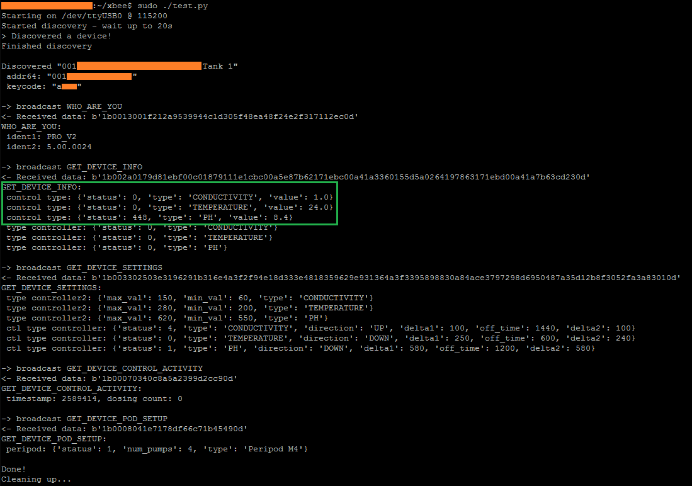
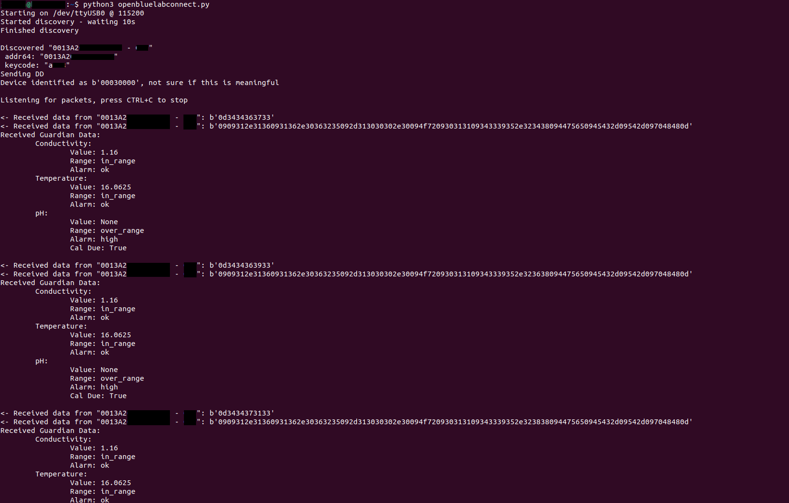

# OpenBluelabConnect 

## What Is This?
This is a proof of concept for how to connect to Bluelab hardware using a `Connect Stick` and python, and read some sensor values. 

## Supported Devices
- `Pro Controller` (V2/V3 firmware) (can read pH, temperature, conductivity, controller/pod settings)
- `Guardian Monitor` (Can read pH, temperature, conductivity only)

**Important:** at the moment, a device has to be connected to the official `Bluelab Connect` software once before it will talk to the script. After that one-time step the script works on its own. This applies to every new device, including additional devices on the same stick.

The `Connect Stick` is the coordinator of a ZigBee network that is normally closed to new devices. When `Bluelab Connect` is looking for a device, it opens the network for joining . Once a device has joined it stays joined, so the script can see it from then on. Doing the same from python (`local_device.set_parameter("NJ", bytes([30]))` before discovery) should remove the need for `Bluelab Connect`, but this hasn't been tested yet.

## Pro Controller

It makes use of the XOR key found in the `Bluelab Connect` software (`[0x6e, 0x67, 0xc5, 0x79, 0xdd, 0x61, 0x02, 0x1a]`). Each packet sent contains a randomly generated byte, which the Bluelab device uses to permute the key. We do the same on reception in order to decode these "obfuscated packets". 

Currently, it broadcasts a select few commands, decodes the responses, prints them to the screen, and keeps listening until you press `CTRL+C`.

Here is what the script output looks like with a Pro Controller (the script has since been renamed from test.py to openbluelabconnect.py):

Currently, it will:
- discover a Bluelab devices in the area (may work with more than one, this is untested)
- determine that device's "keycode" from the 64-bit Xbee address (involves lots of shifting and base36 [yes, base36])
- identify the device (model & firmware version) (WHO_ARE_YOU)
- read and print:
  - sensor values (GET_DEVICE_INFO)
  - min/max setpoints for pumps (GET_DEVICE_SETTINGS)
  - dosing count (GET_DEVICE_CONTROL_ACTIVITY)
  - pod setup (# of pumps, type) (GET_DEVICE_POD_SETUP)

## Guardian Monitor
The `Guardian Monitor` is much simpler than the `Pro Controller`. It doesn't need any of the commands above. Instead, it broadcasts its readings every few seconds. The broadcast data is ASCII, tab-delimited, and starts with `\t\t`.

Here is what the script output looks like with a `Guardian Monitor`:

After the two leading tabs, the fields are:

| Index | Example | Meaning |
| --- | --- | --- |
| 0 | `1.16` | Conductivity |
| 1 | `16.0625` | Temperature |
| 2 | `-1000.0` | unused |
| 3 | `Or` | pH (`Ur`/`Or` = under/over range, value unknown) |
| 4 | `011` | unused |
| 5 | `4395.248` | unused |
| 6 | `Due` | pH calibration due |
| 7 | `E-` | conductivity alarm |
| 8 | `T-` | temperature alarm |
| 9 | `pHH` | pH alarm (ends in `H` = high, `L` = low, `-` = ok, otherwise off) |

For each value the script reports the reading, whether it is in range, and the alarm state. The range limits (conductivity 0-5, temperature 0-50, pH 0-14) and the alarm/range logic are copied from `Bluelab Connect`. In the example above the pH probe was disconnected, so it reads over range with a high alarm.

The `Guardian` also sends short packets like `\r44673` in between readings. I'm not sure what these are, they are currently ignored.

Other notes:
- In discovery the `DD` (device type) parameter reads `00030000`.
- The keycode calculation works the same as for the `Pro Controller`. The value printed by the script matched what `Bluelab Connect` showed.
- Two `Guardian`s on one `Connect Stick` both stream data. The script doesn't tell them apart yet, but every packet is printed with the sender's address.

## How It Was Made
I used decompiler.com (no affiliation, it just happened to work well) to decompile the Bluelab Connect `.jar`, then spent some time analyzing and refactoring the code to understand the packet structure and what packet contents were important. This (incomplete) refactored code is available in the repo. There were some issues with case sensitivity (A.class and a.class can't coexist on Windows, which required switching to Ubuntu) and during refactoring, so the project won't build. Although with some work it probably could. There are a number of dependencies that I didn't include.

The eventual goal was to be able to read sensor values, alarms, and change setpoints. I'd really love to see an MQTT interface, or a simple CSV logger without needing Java.

This was originally tested with a single `Pro Controller`, a `Connect Stick`, and `Ubuntu 18.04`. `Guardian` support was tested with one and then two `Guardian Monitor`s on a single `Connect Stick`, also on Ubuntu.

You will need the following dependencies: `pip install digi-xbee libscrc`.

## Why?
Mostly for the fun of it - I like to take things apart. I wanted to see if I could talk to some Bluelab hardware that I had access to. Plus this was an excellent Java learning experience.

Also, in an admittedly small capacity, I was hoping to get a foot in the door at Bluelab, and get a tour if ever I visit New Zealand. So far, no luck on this front... 

Hopefully someone else finds this code useful! I don't have access to hardware any more, but I would be happy to help if someone else had some kit they wanted to experiment on.

## What This Isn't
A good example of python... Please be kind! I am new to python. This should be rewritten for any serious work.

This also isn't for beginners. At the very least, the serial port will need to be changed to match your setup. At worst, it won't work at all.

## To Do
- [x] proof of concept working
- [ ] fully decode packet structure and translate to python (or finish reversing Bluelab Connect and get it to build)
- [ ] update packet building code to handle data (variable length) (possibly xor'd too)
- [x] test with more types of devices (`Guardian Monitor`)
- [ ] support `pH Controller` and `Pro Controller` V1 
- [ ] be able to change setpoints and peripod settings
- [ ] test with multiple devices connected to one stick (works for two `Guardian`s, untested for `Pro Controller`)
- [ ] auto-detect device type instead of setting `DEVICE_TYPE`
- [ ] open the network for joining so `Bluelab Connect` isn't needed for new devices
- [ ] decode status/alarm bit fields for the `Pro Controller`
- [x] keep connected and keep reading
- [ ] daemonize (maybe log/expose some api)
- [ ] mqtt frontend

## Contact
To get in touch, send an email to jordan [at] skoba [dot] ca